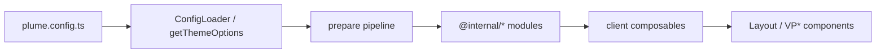

# Repository Guidelines

## Overview

VuePress 2 theme monorepo (`vuepress-theme-plume`). Every package builds to `dist/` — never `lib/`.

| Path | Package | Role |
| --- | --- | --- |
| `theme/` | `vuepress-theme-plume` | Theme: node build pipeline + client runtime |
| `plugins/plugin-search/` | `@vuepress-plume/plugin-search` | Local full-text search (MiniSearch) |
| `plugins/plugin-md-power/` | `vuepress-plugin-md-power` | MarkdownIt enhancements (containers, embeds, charts, REPL…) |
| `plugins/plugin-fonts/` | `@vuepress-plume/plugin-fonts` | Node-only font/icon assets |
| `cli/` | `create-vuepress-theme-plume` | `npm create vuepress-theme-plume` scaffolder |
| `docs/` | private | Docs site (dogfoods theme + plugins) |
| `examples/{pure-blog,layout-slots}` | private | Runnable examples; layout-slots demos theme slots |

## Architecture

`theme/src/` has three layers:

- **`node/`** — build-time. `theme.ts` exports `plumeTheme()`, returning the VuePress theme hook object (`alias`, `plugins`, `extendsPage`, `onInitialized`, `onPrepared`, `onPageUpdated`, `onWatched`, `extendsMarkdownOptions`, `extendsBundlerOptions`, `templateBuildRenderer`, `clientConfigFile`). User config is compiled by `features/loadConfig/` and deep-merged in `options.ts`; **node code reads options only via `getThemeOptions()`**. `prepare/index.ts` runs the data pipeline in parallel: posts data, sidebar, collections, encrypt, icons, tag colors, hero effects, bulletin. `features/` also holds collections (the `post`/`doc` content model), autoFrontmatter, dependency/version detection, and markdown-source watching.
- **`client/`** — browser runtime. `config.ts` installs `setupThemeData`, `setupDarkMode`, `setupCollection`, `setupSidebar`, `setupHeaders`, `setupEncrypt`, `setupWatermark`; `layouts/Layout.vue` is the shell and slot surface. Components consume state only through `composables/`.
- **`shared/`** — type-only public surface (`options`, `data`, `pageData`, `frontmatter`, `features`, `resolved`, `locale`); no runtime values.

Data flow:



Search has no index in the theme: `components/Nav/VPNavBarSearch.vue` renders the global `SearchBox` from `plugin-search` or `@vuepress/plugin-docsearch`, chosen in `node/plugins/setupPlugins.ts`.

Key directories: `theme/src/node/{config,features,prepare,pages,plugins,locales,utils}/`, `theme/src/client/{components,composables,layouts,features,styles}/`, `plugins/*/src/{node,client,shared}/`, `cli/src/` + `cli/templates/`, `docs/.vuepress/`, `scripts/`.

## Commands

```bash
pnpm install                 # pnpm only
pnpm build                   # clean + build all packages → dist/
pnpm dev                     # theme/plugin watchers + docs dev server
pnpm dev:package             # watchers for packages that define dev

pnpm test                    # TZ=Etc/UTC vitest --coverage (watch on TTY)
pnpm test --run              # single run
pnpm test theme/src/node/__test__/configLoader.spec.ts
pnpm test -t '<name>'        # name filter

pnpm lint                    # eslint + stylelint + markdownlint
pnpm lint:fix

pnpm docs:dev                # waits for theme/dist/node/index.js
pnpm docs:build              # vuepress build + lunaria
pnpm docs:serve
pnpm --filter pure-blog docs:dev   # examples need a built theme
pnpm release                 # release:check (lint + build) then bumpp
```

Packages resolve from `dist/` at runtime: rebuild after editing `src/` (`pnpm build`, or `pnpm dev` for watchers). Only `theme` and `plugin-md-power` define a `dev` script.

## Conventions

- **ESM everywhere.** Relative imports include `.js` even from `.ts`. Order: `import type`, external, relative.
- **Aliases:** `@theme/<Component>.vue` and `@internal/<module>` (virtual modules, typed in `client/shim.d.ts` — declare new ones there). Public subpaths: `vuepress-theme-plume/client`, `/shared`, `/composables`, `/components/*`, `/features/*`.
- **Naming:** kebab-case files (`posts-data.ts`; legacy camelCase remains), camelCase functions with `prepareX`/`resolveX`/`detectX`/`setupX`/`generateX`; components `VP*` PascalCase; composables `useX`; types `Theme*`/`Resolved*`; constants `UPPER_SNAKE`.
- **Errors:** `logger` from `node/utils`; wrap fallible IO in `attemptAsync`/try-catch that logs and continues. Config failures are recorded in `ConfigLoader` and surfaced by `configLoader.waiting()`.
- **Async:** `Promise.all` for independent prepare steps, `p-map` for bounded concurrency, chokidar watchers registered in `onWatched`, module-level `Map`/`LRUCache` caches.
- **Client DI/state:** `createSymbol()` → `app.provide` in a `setupX()` installer → `useX()` that `inject()`s and throws `'useX() is called without provider.'`. State lives in module-scoped `ref`/`computed` singletons hydrated from `@internal/*`; HMR guarded by `__VUEPRESS_DEV__`. No pinia/vuex.
- **Comments:** exported symbols carry bilingual (English + Chinese) JSDoc; mark deprecations with `@deprecated` plus a migration path.
- **Formatting/lint:** eslint (`@pengzhanbo/eslint-config-vue`), stylelint, markdownlint; **no Prettier**. JS output is formatted/stripped at build time by `scripts/strip-comments.ts` (oxfmt) — do not reformat unrelated code.
- **Commits:** Conventional Commits via commitlint; scopes are `docs`, `theme`, `cli`, and each plugin directory name.
- **TypeScript:** root `tsconfig.base.json` (strict preset, target ES2023, `moduleResolution: Bundler`, `noImplicitAny: false`); no per-package tsconfigs; dts emitted by tsdown.
- **Dependencies:** use catalogs in `pnpm-workspace.yaml` (`dev`/`prod`/`peer`/`vuepress`) with `"catalog:<name>"`; workspace deps use `workspace:*`. Optional peers (e.g. `three`, `swiper`, `gsap`, `ogl`, `postprocessing`, `pinyin-pro`, `@mathjax/src`, `@iconify/json`) must never become hard dependencies — detect with `isPackageExists` and warn.

## Testing

- Vitest 5, single root `vitest.config.ts`, node environment, no setup files, no globals (`import { describe, expect, it } from 'vitest'`).
- Specs live under `__test__/`: `cli/__test__/`, `plugins/*/__test__/`, `theme/src/node/__test__/`, `theme/src/client/__test__/`. Include pattern `**/__test__/**/*.spec.[tj]s`; no shared test utils.
- Mock with `vi.mock` (e.g. `memfs` for `node:fs`); real-FS fixtures belong in `<spec dir>/.tmp/` (gitignored, never the OS temp dir) and are cleaned in `afterEach`/`afterAll`; platform-dependent tests use `it.skipIf`; snapshots only for `plugin-md-power` markdown output.
- Coverage is v8 (`text`/`clover`/`json`) with **no thresholds**; cover behavior, boundaries, and error paths.

## Environment & CI

- Node `^20.19.0 || >=22.12.0` (CI uses 24); pnpm `>=12.6.0` (`packageManager: pnpm@12.10.1`). `pnpm-workspace.yaml` also pins `catalogMode: prefer`, `minimumReleaseAge` (5 days) and `trustPolicy`.
- Build with tsdown (`--config-loader unrun`); static assets (`.vue`, `.css`, `.scss`, images, fonts, `.d.ts`) are copied by `cpx`. Client bundles externalize `*.vue`, `*.css`, `@internal`, `@theme`, and shared barrels.
- Docs/examples use `@vuepress/bundler-vite` + VuePress `2.0.0-rc.31` (exact pins in the `vuepress` catalog).
- CI workflows: `lint`, `test`, `docs-deploy`, `example-layout-slots-deploy`, `release`, `star-history`. Pre-commit runs eslint/stylelint fixes and `vitest related --run` for staged JS/TS changes.
