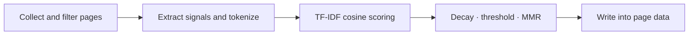

## Overview

Show related content at the bottom of article and doc pages, helping readers keep reading
and strengthening internal linking.

The result is computed at ==build time== and written into the page data, so the client only
renders it:

- **Zero runtime cost**: no extra first-screen JavaScript, no vector database, no external service
- **Crawlable**: outputs real static `<a>` elements, so search engines can follow the internal links
- **Predictable**: rebuilding the same source produces the same result

:::: info Disabled by default

`relatedPosts` is disabled by default. Enable it explicitly — `relatedPosts: true` uses all defaults.

::::

## Getting started

:::: steps

1. **Enable it**

   `true` means "enable with the default configuration":

   ```ts title=".vuepress/config.ts"
   import { defineUserConfig } from 'vuepress'
   import { plumeTheme } from 'vuepress-theme-plume'

   export default defineUserConfig({
     theme: plumeTheme({
       relatedPosts: true,
     }),
   })
   ```

2. **Customize it**

   Pass an object to override any default:

   ```ts title=".vuepress/config.ts"
   export default defineUserConfig({
     theme: plumeTheme({
       relatedPosts: {
         limit: 4,
         minScore: 0.12,
         diversity: 0.3,
       },
     }),
   })
   ```

3. **Build and check**

   The result is generated during the build — open any article and scroll to the bottom:

   ```sh
   pnpm docs:build
   ```

::::

### Enable it for a single collection

Collection level options take precedence over the theme level ones, and other collections
stay untouched:

```ts title=".vuepress/config.ts"
export default defineUserConfig({
  theme: plumeTheme({
    collections: [
      {
        type: 'post',
        dir: 'blog',
        title: 'Blog',
        relatedPosts: { limit: 6 },
      },
    ],
  }),
})
```

## How it works



### Signals

Every page of a collection contributes the following signals:

| Signal | Source | Default weight |
| --- | --- | --- |
| Tags | `frontmatter.tags` | 3 |
| Categories | auto category result | 2 |
| Title | page title | 2 |
| Headings | `##` ~ `######` in the body | 1.5 |
| Body | Markdown body (first 2000 characters) | 1 |

Signals become field-prefixed terms (the tag `vue` becomes `#g:vue`) and pairs are scored
with **TF-IDF + cosine similarity**.

- **Same collection, same locale**: pages are only recommended within the current collection
  and locale by default, so blog and doc, or `/` and `/en/`, never pollute each other
- **Candidate pruning**: an inverted index is built first, and only pages sharing at least one
  term are scored, which is close to linear
- **High frequency pruning**: body terms appearing in more than 30% of the documents are
  ignored (only when the group has at least 10 documents). Tags, categories and titles are
  never pruned
- **Diversity**: before taking the Top-N, MMR (maximal marginal relevance) re-selects from a
  wider candidate pool, so the results are not all adjacent articles of the same series
- **Determinism**: equal scores are ordered by create time and path

:::: note Why not vector search

Doc sites usually have hundreds to a few thousand pages. TF-IDF wins on explainability,
build time and artifact size, and it never needs to call an external service.

::::

## Configuration

See [Theme config - relatedPosts](../../config/theme.md#relatedposts) for the full reference.

| Option | Type | Default | Description |
| --- | --- | --- | --- |
| `limit` | `number` | `4` | Max number of items (1–12) |
| `minScore` | `number` | `0.12` | Similarity threshold |
| `diversity` | `number` | `0.3` | Diversity of the result, `0` disables it |
| `recency` | `number` | `0` | Recency decay half-life in years, `0` disables it |
| `scope` | `'collection' \| 'locale'` | `'collection'` | Candidate scope |
| `weights` | `object` | see above | Weight of each signal |
| `showExcerpt` | `boolean` | `false` | Show an excerpt in each item |
| `contentLimit` | `number` | `2000` | Characters of the body used for scoring |
| `cjk` | `'segmenter' \| 'bigram'` | `'segmenter'` | CJK tokenizer strategy |
| `exclude` | `string[]` | `[]` | Paths to exclude, glob supported |
| `debug` | `boolean` | `false` | Print scores in the build log |

::: tip Common combinations

- **More focused**: lower `diversity` (e.g. `0.1`) or raise `minScore`
- **More diverse**: raise `diversity` (e.g. `0.5`) or lower `minScore`
- **Prefer newer articles**: set `recency` (e.g. `0.5` for a half-year half-life)
- **Recommend across collections**: set `scope: 'locale'`

:::

## Manual override

A single page can fully own its related posts through frontmatter:

```yaml title="blog/hello.md"
---
relatedPosts:
  - /blog/vue3-reactivity/
  - /blog/vue3-computed/
---
```

Or disable the block for that page:

```yaml title="blog/hello.md"
---
relatedPosts: false
---
```

The manual list is resolved at ==build time==: a link pointing to a missing page produces a
build warning instead of a broken link.

## Tuning

:::: steps

1. **Enable the debug log**

   ```ts title=".vuepress/config.ts"
   export default defineUserConfig({
     theme: plumeTheme({
       relatedPosts: { debug: true },
     }),
   })
   ```

2. **Inspect the score distribution**

   The build log prints the Top-N scores of every page:

   ```log
   [related-posts]
   /blog/vue3-reactivity/
     0.482  /blog/vue3-ref/
     0.311  /blog/vue3-computed/
   ```

3. **Adjust against the symptom**

   | Symptom | Adjustment |
   | --- | --- |
   | Most pages have no items | Lower `minScore` (e.g. `0.08`) or raise `weights.content` |
   | Clearly unrelated items | Raise `minScore` (e.g. `0.2`), raise `weights.tags`, lower `weights.content` |
   | Highly repetitive items | Raise `diversity` |
   | Old articles dominate | Set `recency` |

::::

## Notes

- **Encrypted and draft pages never appear in the result**
- Only real Markdown content pages take part: pages with `article: false`, `home` / `friends`
  layouts and theme-generated virtual pages (tags, archives, …) are excluded
- `frontmatter.relatedPosts` list only takes effect inside a collection where the
  feature is enabled
