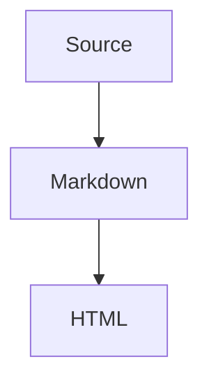

# VuePress Plume Skills

Specialised [agent skills](https://skills.sh) for the VuePress Plume theme. They give an AI agent the exact
option names, defaults and syntax of the theme, so generated config and markdown actually build.

> Content is aligned with `vuepress-theme-plume@1.0.0-rc.218` (VuePress `2.0.0-rc.32`).
> When the theme adds or changes options, update `SKILL.md` plus the matching `references/` / `resources/` file.

## 1. Skills

| Skill | Purpose | Layout |
| --- | --- | --- |
| **vuepress-plume-config** | Generate and maintain theme config | `SKILL.md` + `references/` (theme-options, collections, navigation, locales, features, plugins, markdown, frontmatter) |
| **vuepress-plume-markdown** | Write page content | `SKILL.md` + `resources/` (50+ per-feature syntax sheets) |

**vuepress-plume-config** covers:

- The two config surfaces — `.vuepress/config.ts` (full) and `.vuepress/plume.config.ts` (hot-reloadable subset) —
  and which fields may go where.
- Collections (`post` / `doc`), cover styles, `meta`, collection-level `feed` / `relatedPosts`.
- Navigation: `navbar`, `sidebar`, `defineNavbarConfig`, `defineCollection`.
- i18n: built-in languages, path mapping, every text key.
- Features: `search`, `comment`, `watermark`, `encrypt`, `llmstxt`, `bulletin`, `copyright`, `replaceAssets`,
  `feed`, `series`, `relatedPosts`, `linkPreview`, `readerPreferences`, `changelog`, `contributors`,
  SEO / sitemap, image preview.
- `plugins.*` (built-in plugins and precedence), all `markdown` / `codeHighlighter` switches with defaults.
- Page frontmatter (common, post, home, friends).

**vuepress-plume-markdown** covers:

- Containers: `hint`, `details`, `tabs`, `code-tabs`, `steps`, `timeline`, `collapse`, `chat`, `field`, `card`,
  `window`, `flex`, `table`, `file-tree`, `code-tree`, `demo`, `encrypt`, `qrcode`.
- Inline syntax: `==mark==`, `::icon::`, `!!plot!!`, `[+annotation]`, abbreviations, `{.attrs}`, math, emoji,
  Obsidian wiki links / callouts / comments.
- Embeds: Bilibili, YouTube, AcFun, ArtPlayer, AudioReader, PDF, CodePen, CodeSandbox, JSFiddle, REPL.
- Charts: Mermaid, ECharts, Chart.js, Markmap, PlantUML, Flowchart.
- Code blocks: title, line numbers, highlight, focus, diff, word highlight, collapsed lines, `@[code]`, twoslash.
- Page authoring: article frontmatter, home `config` sections, friend-links page, `<Card>` / `<Badge>` / `<Swiper>`
  and other components.

### Which skill should trigger?

- Configuration work (site init, collections, navbar/sidebar, locales, enabling a feature, frontmatter keys)
  → **vuepress-plume-config**.
- Content work (writing `.md`, "how do I write X", picking a container/chart/embed) → **vuepress-plume-markdown**.

## 2. Install

```bash
# all skills into the current project (recommended for teams)
npx skills add https://github.com/pengzhanbo/vuepress-theme-plume

# one skill only
npx skills add https://github.com/pengzhanbo/vuepress-theme-plume --skill vuepress-plume-markdown

npx skills list
```

Alternatively copy the directories under `skills/` into your agent's skill folder (`.claude/skills/`,
`.codebuddy/skills/`, …).

| Agent | Install |
| --- | --- |
| Claude Code | `npx skills add <repo> -a claude-code` (detects `.claude/skills`) |
| OpenCode | `npx skills add <repo> -a opencode` |
| Trae / other IDEs | keep `skills/` in the workspace; agents scan `SKILL.md` files |

If a skill is not picked up, verify the `name` / `description` frontmatter in `SKILL.md`.

## 3. Examples

### vuepress-plume-config

**Blog with feed, related posts and reader preferences**

> "Set up my Plume blog: `blog/` as a post collection, RSS feed, related posts, reader preferences — and put the
> hot-reloadable parts in `plume.config.ts`."

The agent keeps `hostname` in `plumeTheme()` and writes `feed`, `relatedPosts`, `readerPreferences`,
`collections` into `plume.config.ts`.

**Docs collection with an auto sidebar**

```ts
// .vuepress/plume.config.ts
import { defineThemeConfig } from 'vuepress-theme-plume'

export default defineThemeConfig({
  collections: [{ type: 'doc', dir: 'guide', title: 'Guide', sidebar: 'auto' }],
  navbar: [{ text: 'Guide', link: '/guide/', icon: 'mdi:book-open-outline' }],
})
```

**Partial encryption**

```ts
plumeTheme({
  encrypt: { rules: { '/secret/': 'mypassword' } },
})
```

### vuepress-plume-markdown

**Timeline**

````markdown
:::: timeline
- Node 1
  time=2025-03-20 type=success

  Content

- Node 2
  time=2025-02-21 type=warning

  Content
::::
````

**Code block with features**

````markdown
```ts title="example.ts" :line-numbers {2-4}
const line1 = 'normal'
const line2 = 'highlighted'
const line3 = 'highlighted'
const line4 = 'highlighted'
```
````

**Embed, chart, LLM-only content**

```markdown
@[bilibili](BV1xx411c7mD)
```

````markdown

````

```markdown
<llm-only>

## Content for LLMs only

</llm-only>
```

## 4. Best practices

- **Version control:** commit project-level skills so the whole team gets the same behaviour.
- **Updates:** re-run `npx skills update` after a theme upgrade, or diff against the version noted above.
- **Enable before writing:** most markdown extensions are off by default — enable them in
  `plumeTheme({ markdown: { ... } })` first (see the defaults table in `vuepress-plume-markdown/SKILL.md`).
- **Verify:** run `pnpm vuepress build` after generated config changes.
- **Encryption:** page/snippet encryption requires HTTPS.
- **Cache:** remove `--clean-cache` from the dev script after enabling `cache`.
- **Chart scripts:** ECharts / Chart.js JS configs are inert unless `DANGEROUS_*` switches are enabled.

## 5. Resources

- [Theme config](https://theme-plume.vuejs.press/config/theme/)
- [Collections](https://theme-plume.vuejs.press/config/collections/)
- [Markdown config](https://theme-plume.vuejs.press/config/markdown/)
- [Markdown extensions](https://theme-plume.vuejs.press/guide/markdown/basic/)
- [Code features](https://theme-plume.vuejs.press/guide/code/features/)
- [Components](https://theme-plume.vuejs.press/guide/components/card/)
- [VuePress](https://v2.vuepress.vuejs.org/)
- [VuePress Theme Plume](https://github.com/pengzhanbo/vuepress-theme-plume)
