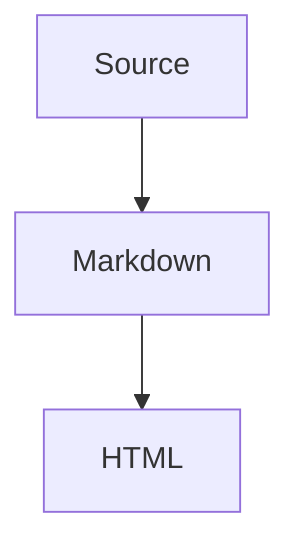

# VuePress Plume Skills

此目录包含为 VuePress Plume 主题定制的专用技能（Skills），用于让 AI 代理准确理解主题的配置项与
Markdown 语法。

> 内容已对齐 `vuepress-theme-plume@1.0.0-rc.218`（对应的 VuePress `2.0.0-rc.32`）。
> 主题升级后如果新增/调整了配置项，请同步更新对应的 `SKILL.md` 与 `references/`、`resources/`。

## 1. 技能介绍

### 🌟 可用技能

| 技能名称 | 描述 | 结构 |
| --- | --- | --- |
| **vuepress-plume-config** | 主题配置生成与维护 | `SKILL.md` + `references/`（theme-options、collections、navigation、locales、features、plugins、markdown、frontmatter） |
| **vuepress-plume-markdown** | Markdown 内容写作 | `SKILL.md` + `resources/`（50+ 个按功能拆分的语法速查） |

**vuepress-plume-config** 覆盖：

- 两种配置入口：`.vuepress/config.ts`（全量）与 `.vuepress/plume.config.ts`（热更新子集），以及各字段能否放入后者
- 集合（`collections`）模型：`post` / `doc`、封面样式、`meta`、集合级 `feed` / `relatedPosts`
- 导航：`navbar`、`sidebar`、`defineNavbarConfig` / `defineCollection`
- 多语言：语言列表、路径映射、全部界面文案键
- 功能开关与配置：`search`、`comment`、`watermark`、`encrypt`、`llmstxt`、`bulletin`、`copyright`、
  `replaceAssets`、`feed`、`series`、`relatedPosts`、`linkPreview`、`readerPreferences`、`changelog`、
  `contributors`、SEO / sitemap、图片预览
- `plugins.*` 内置插件表与优先级，`markdown` / `codeHighlighter` 全部开关及默认值
- 页面 frontmatter（通用 / post / 首页 / 友链）

**vuepress-plume-markdown** 覆盖：

- 容器：`hint`、`details`、`tabs`、`code-tabs`、`steps`、`timeline`、`collapse`、`chat`、`field`、`card`、
  `window`、`flex`、`table`、`file-tree`、`code-tree`、`demo`、`encrypt`、`qrcode`
- 行内语法：`==高亮==`、`::icon::`、`!!隐秘!!`、`[+注释]`、缩写、属性 `{.cls}`、数学公式、emoji、
  Obsidian wiki 链接 / callout / 注释
- 嵌入：Bilibili、YouTube、AcFun、ArtPlayer、AudioReader、PDF、CodePen、CodeSandbox、JSFiddle、REPL
- 图表：Mermaid、ECharts、Chart.js、Markmap、PlantUML、Flowchart
- 代码块特性（标题、行号、高亮、focus、diff、word highlight、折叠、`@[code]` 导入、twoslash）
- 页面写作：文章 frontmatter、首页 `config` 区域、友链页、`<Card>` / `<Badge>` / `<Swiper>` 等组件

### 🔍 选择指南

- **使用 `vuepress-plume-config`：** 初始化站点、增改集合/导航/侧边栏/多语言、开启某个功能、
  写 frontmatter、调整 `markdown` 开关。
- **使用 `vuepress-plume-markdown`：** 编写或修改 `.md` 内容、回答"某个语法怎么写"、
  选择用哪个容器/图表/嵌入方式。

---

## 2. 安装

```bash
# 安装全部技能到当前项目（团队协作推荐）
npx skills add https://github.com/pengzhanbo/vuepress-theme-plume

# 仅安装其中一个
npx skills add https://github.com/pengzhanbo/vuepress-theme-plume --skill vuepress-plume-config

# 查看已安装
npx skills list
```

也可直接把 `skills/` 下的目录复制到代理约定的技能目录（如 `.claude/skills/`、`.codebuddy/skills/`）。

### 集成

| 代理 | 安装方式 |
| --- | --- |
| Claude Code | `npx skills add <repo> -a claude-code`，会自动检测 `.claude/skills` |
| OpenCode | `npx skills add <repo> -a opencode`，安装后自动索引 |
| Trae / 其它 IDE | 将 `skills/` 放到工作区，代理会扫描其中的 `SKILL.md` |

若代理未识别技能，检查 `SKILL.md` 的 frontmatter 是否包含合法的 `name` 与 `description`。

---

## 3. 使用示例

### 🛠️ vuepress-plume-config

**初始化博客（含 feed 与阅读偏好）**

> "帮我配置一个 Plume 博客站点：`blog/` 目录作为 post 集合，开启 RSS 订阅、相关文章、阅读偏好，
> 并把可以热更新的字段放到 `plume.config.ts`。"

代理会区分两个配置入口：`hostname` 只能写在 `plumeTheme()` 中，而 `feed`、`relatedPosts`、
`readerPreferences`、`collections` 等支持热更新的字段会写入 `plume.config.ts`。

**文档集合 + 侧边栏**

> "把 `guide/` 目录注册为 doc 集合，侧边栏自动生成，并在导航栏加一个'指南'入口。"

```ts
// .vuepress/plume.config.ts
import { defineThemeConfig } from 'vuepress-theme-plume'

export default defineThemeConfig({
  collections: [{ type: 'doc', dir: 'guide', title: '指南', sidebar: 'auto' }],
  navbar: [{ text: '指南', link: '/guide/', icon: 'mdi:book-open-outline' }],
})
```

**部分加密**

> "给 `/secret/` 下的所有页面设置密码，并允许文章级 `password` 覆盖。"

```ts
plumeTheme({
  encrypt: { rules: { '/secret/': 'mypassword' } },
})
```

### 📝 vuepress-plume-markdown

**时间轴**

````markdown
:::: timeline
- 节点一
  time=2025-03-20 type=success

  正文内容

- 节点二
  time=2025-02-21 type=warning

  正文内容
::::
````

**带特性的代码块**

````markdown
```ts title="example.ts" :line-numbers {2-4}
const line1 = 'normal'
const line2 = 'highlighted'
const line3 = 'highlighted'
const line4 = 'highlighted'
```
````

**嵌入 Bilibili / 图表 / LLM 标记**

```markdown
@[bilibili](BV1xx411c7mD)
```

````markdown

````

```markdown
<llm-only>

## 仅 LLM 可见的内容

</llm-only>
```

---

## 4. 最佳实践

- **版本控制：** 项目级 Skill 建议提交到 Git，保证团队一致。
- **更新：** 主题升级后执行 `npx skills update`，或按本文档开头的版本说明核对差异。
- **功能启用：** 大多数 Markdown 扩展默认关闭，先在 `plumeTheme({ markdown: { ... } })` 中开启，
  再编写语法（默认开启项见 `vuepress-plume-markdown/SKILL.md`）。
- **审查改动：** 配置由代理生成后，仍建议 `pnpm vuepress build` 验证一次。
- **加密：** 文章级/片段级加密依赖 HTTPS。
- **缓存：** 启用 `cache` 后需从 dev 脚本移除 `--clean-cache`。
- **图表脚本：** ECharts / Chart.js 的 JS 配置默认不执行，除非显式开启 `DANGEROUS_*` 开关。

---

## 5. 资源

- [主题配置](https://theme-plume.vuejs.press/config/theme/)
- [集合配置](https://theme-plume.vuejs.press/config/collections/)
- [Markdown 配置](https://theme-plume.vuejs.press/config/markdown/)
- [Markdown 扩展](https://theme-plume.vuejs.press/guide/markdown/basic/)
- [代码特性](https://theme-plume.vuejs.press/guide/code/features/)
- [内置组件](https://theme-plume.vuejs.press/guide/components/card/)
- [VuePress](https://v2.vuepress.vuejs.org/)
- [VuePress Theme Plume](https://github.com/pengzhanbo/vuepress-theme-plume)
