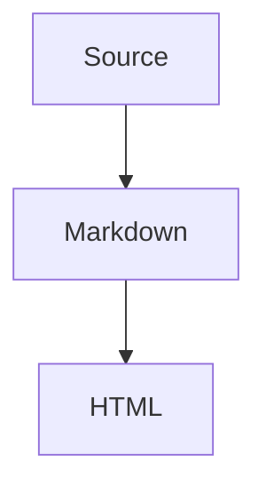
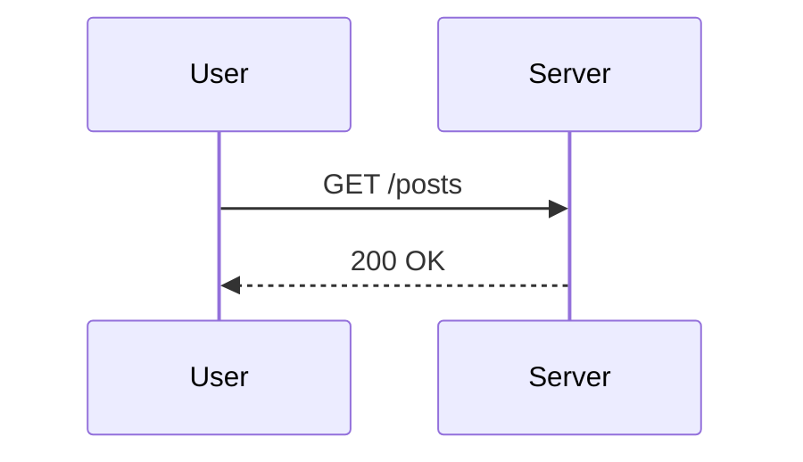

# Mermaid

## Enable

```ts
markdown: { mermaid: true }
```

Requires `npm install mermaid` in the project.

## Syntax

````md

````

Or use a diagram alias as the fence language (no need to declare the diagram type, no indentation needed):

````markdown
```sequence 代码标题
Alice->>Bob: Hi
```
````

## Fence aliases → Mermaid diagram

| Alias | Diagram | Alias | Diagram |
| --- | --- | --- | --- |
| `agentflow` | `agentflow-beta` | `radar` | `radar-beta` |
| `architecture` | `architecture-beta` | `requirement` | `requirementDiagram` |
| `block` | `block` | `sankey` | `sankey` |
| `c4c` | `C4Context` | `sequence` | `sequenceDiagram` |
| `class` | `classDiagram` | `state` | `stateDiagram-v2` |
| `er` | `erDiagram` | `timeline` | `timeline` |
| `gantt` | `gantt` | `treemap` | `treemap-beta` |
| `git-graph` | `gitGraph` | `treeview` | `treeView-beta` |
| `ishikawa` | `ishikawa-beta` | `usecase` | `usecase-beta` |
| `journey` | `journey` | `venn` | `venn-beta` |
| `kanban` | `kanban` | `wardley` | `wardley-beta` |
| `mindmap` | `mindmap` | `xy` | `xychart` |
| `packet` | `packet` | | |
| `pie` | `pie` | | |
| `quadrant` | `quadrantChart` | | |

Do **not** use `sankey-beta` or `xychart-beta` as fence languages — the aliases are `sankey` and `xy`.

## Examples

````md

````

````md
```pie
"A" : 40
"B" : 60
```
````

## Advanced

```ts
// .vuepress/client.ts
import { defineMermaidConfig } from '@vuepress/plugin-markdown-chart/client'
import { defineClientConfig } from 'vuepress/client'

defineMermaidConfig({ theme: 'neutral' })

export default defineClientConfig({})
```
